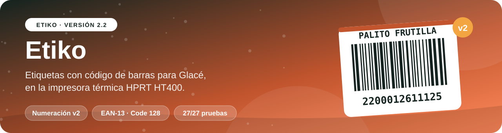
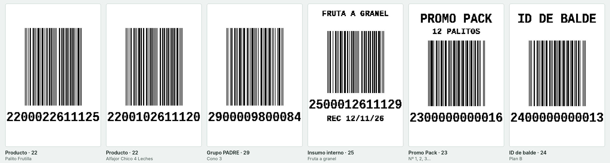
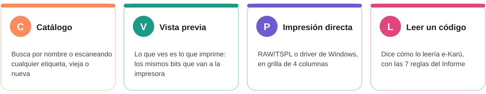
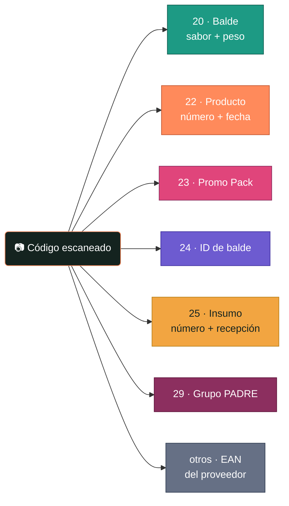
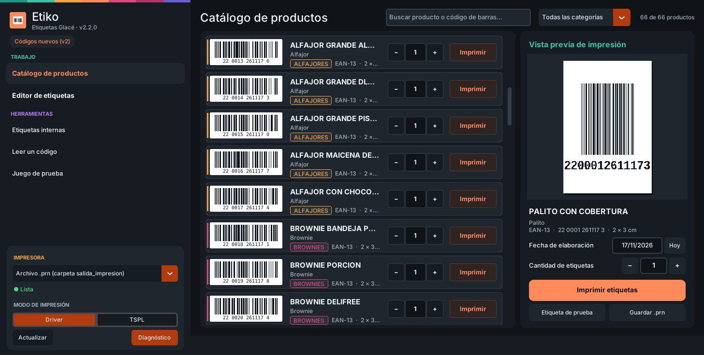
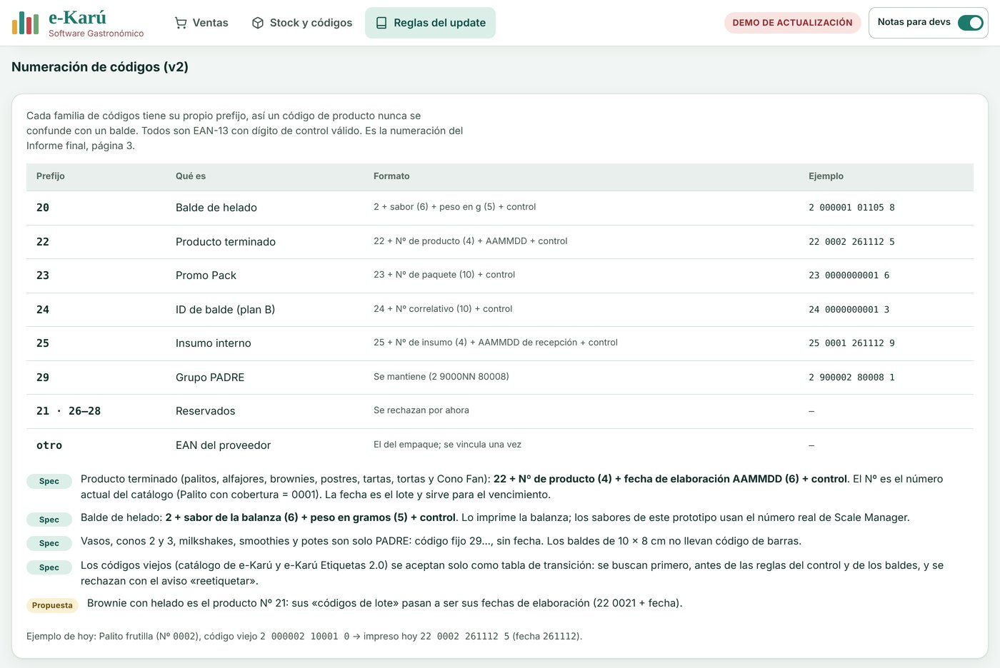
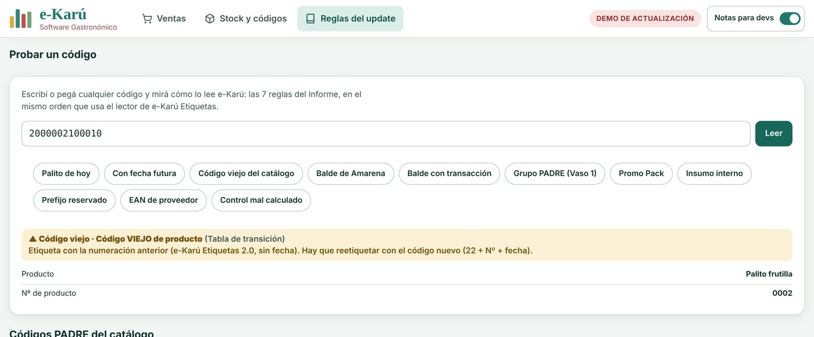
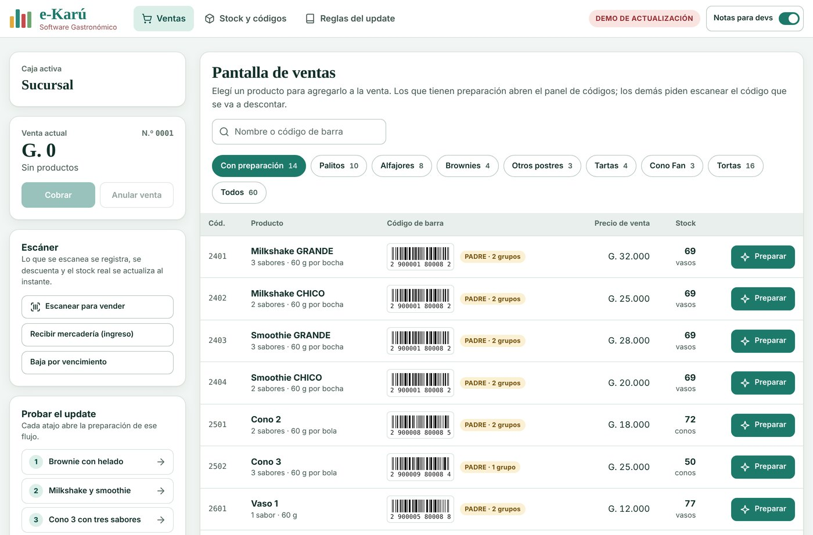

<div align="center">




<sub>Antes se llamaba «E-Karú Etiquetas». e-Karú es la caja; Etiko es solo el programa de la impresora.</sub>




<a href="https://claude.ai/artifact/6RK7nyF9HsXZztpKUsCuZy"></a>

</div>



### 🎨 Cada familia, su prefijo



## ✨ Qué hace

- **Catálogo de productos** con su código de barras (EAN-13 válido o Code 128) y la cantidad por imprimir. Se busca por nombre **o escaneando una etiqueta**: encuentra el producto aunque la etiqueta sea de otro día o de la numeración anterior.
- **Vista previa idéntica a lo impreso**: el código se dibuja con los mismos bits que se mandan a la impresora.
- **Impresión directa** en RAW/TSPL (sin pywin32) o por el driver de Windows (GDI), en grilla de 4 columnas, con densidad, velocidad y márgenes configurables.
- **Diagnóstico de impresión** y registro (`ekaru_impresion.log`) para cuando algo no sale.

Los baldes los etiqueta la balanza con su software (Scale Manager). Esta app solo agrega, como plan B, una etiqueta de **ID de balde** (código 24). El proceso completo está en [ekaru-procesos](https://github.com/alvaroliuzzi-bot/ekaru-procesos).

<p align="center"><br><sub>Pantalla principal de la 2.2 en Windows.</sub></p>

### Diseño (2.2)

Grafito con un acento coral y etiquetas blancas: el coral marca solo lo que se toca (imprimir, la fila elegida, el campo donde se escribe). Contraste WCAG 2.2 AA en textos y botones, botones de cantidad más grandes, borde visible en el campo con el foco y la fila elegida marcada también con una franja (no solo por color).


## 🆕 Novedades de la 2.1

Todo sale del [Informe final](https://github.com/alvaroliuzzi-bot/ekaru-procesos), página «Códigos de barras».

| | Novedad |
|---|---|
| **Numeración v2** | Los productos terminados se imprimen como `22` + Nº de producto + fecha de elaboración + control. Cada familia tiene su prefijo y ya no se confunde un producto con un balde. |
| **Fecha de elaboración** | Un campo sobre la cantidad: arranca en hoy y pasa solo al día nuevo después de medianoche. Se puede escribir otro día (no futuro, hasta 400 días atrás) y «Hoy» vuelve a la fecha actual. |
| **Etiquetas internas** | Insumo (`25`, con fecha de recepción), Promo Pack (`23`) e ID de balde (`24`). Los números salen correlativos y el contador avanza **solo si el envío a la impresora salió bien**. |
| **Leer un código** | Escaneás o escribís un código y la app dice cómo lo leería e-Karú: correcto, código viejo (hay que reetiquetar), rechazado o código externo. Aplica las 7 reglas del Informe en el mismo orden. |
| **Juego de prueba** | Una etiqueta de cada familia (marcada «PRUEBA») para probar los escáneres de punta a punta. |
| **Tabla de transición** | CSV para Excel con los 47 productos y los 9 grupos PADRE: código del catálogo de e-Karú, código de la 2.0 y código nuevo. |
| **Aviso y vuelta atrás** | La primera vez que se imprime un producto la app explica el cambio y pide confirmarlo. Se puede volver a la numeración anterior en **Diagnóstico → Ajustes**. |

> [!WARNING]
> **Antes de vender con los códigos nuevos**, la caja (e-Karú) tiene que tenerlos cargados. Las etiquetas viejas que ya están pegadas se reconocen en «Leer un código».

### Numeración v2 en una tabla

| Prefijo | Qué es | Formato | Ejemplo |
|---|---|---|---|
| `20` | Balde (lo imprime la balanza) | `2` + sabor (6) + peso en g (5) + control | `2 000001 01105 8` |
| 21 dígitos | Balde único, Code 128 (propuesta) | `2` + sabor + peso + transacción (8) + control | `2 000001 01105 00041129 3` |
| `22` | **Producto terminado** | `22` + Nº de producto (4) + AAMMDD + control | `22 0001 261112 8` |
| `23` | Promo Pack | `23` + Nº de paquete (10) + control | `23 0000000001 6` |
| `24` | ID de balde (plan B) | `24` + Nº correlativo (10) + control | `24 0000000001 3` |
| `25` | Insumo interno | `25` + Nº de insumo (4) + AAMMDD de recepción + control | `25 0001 261112 9` |
| `29` | Grupo PADRE | se mantiene: `2 9000NN 80008` | `2 900002 80008 1` |
| `21`, `26`–`28` | Reservados | se rechazan por ahora | |
| otros | EAN del proveedor | el del empaque | |

El Nº de producto es el del catálogo (Palito con cobertura = 1 … 47). Todos los códigos internos tienen 13 dígitos con control EAN-13 válido; el balde único tiene 21 dígitos (Code 128).

<p align="center"></p>

<details>
<summary><b>Las 7 reglas de lectura</b> (en este orden, en «Leer un código» y en el prototipo)</summary>

1. 21 dígitos: balde único (Code 128).
   Antes de la 2 y la 3, el código se busca en la **tabla de transición**: si es uno viejo exacto, se avisa «reetiquetar».
2. 13 dígitos con el dígito de control mal calculado: rechazado, y se muestra cuál debería ser.
3. Prefijo `20`: balde, con el sabor y el peso (0,5 a 12 kg).
4. Prefijo `22`: producto. El Nº tiene que existir y la fecha ser real y no futura.
5. Prefijos `23`, `24`, `25` y `29`: Promo Pack, ID de balde, insumo (Nº y fecha de recepción) y grupo PADRE.
6. Prefijos `21` y `26`–`28`: reservados, se rechazan.
7. Cualquier otro: EAN de proveedor.

</details>


## 🚀 Empezar (Windows)

1. Instalar Python 3 desde python.org y marcar **«Add to PATH»**.
2. Doble clic en **`Iniciar_Ekaru.bat`**. La primera vez instala `customtkinter`.
3. `Crear_Acceso_Directo.bat` deja el acceso directo en el escritorio. `Iniciar_Ekaru_DEBUG.bat` abre con consola para ver errores.

### Actualizar desde la 2.0 (y volver atrás)

1. Con la app cerrada, hacé una copia de `app.py` y `ekaru_ventas.html` (por ejemplo en una carpeta `_respaldo`).
2. Reemplazalos por los de la 2.1 y agregá `tabla_transicion_codigos.csv` si querés tenerla a mano.
3. ⚠️ **No pises** `ekaru_config.json` ni `cantidades_impresion.json`: ahí quedan la impresora, los márgenes y las últimas cantidades. La 2.1 los lee tal cual.
4. Para volver a la 2.0, copiá de nuevo los dos archivos de la copia. Los archivos nuevos (`contadores.json`, `insumos.json`) no molestan a la 2.0.


## 🧰 Herramientas (barra lateral)

| Herramienta | Para qué |
|---|---|
| **Etiquetas internas** | Insumo (25), Promo Pack (23) e ID de balde (24). Los insumos se pueden agregar desde la misma ventana (`insumos.json`; los números son provisorios hasta que Glacé y e-Karú los acuerden). Los últimos números impresos quedan en `contadores.json`. |
| **Leer un código** | Para el lector de códigos: Enter después de cada lectura, historial de la sesión y la tabla de transición a un clic. |
| **Juego de prueba** | Imprime 5 etiquetas de prueba, una de cada familia; todas tienen que dar «código correcto» en el lector. |

<p align="center"></p>


## 🧪 Pruebas

```bash
python tools/prueba_numeracion.py
```

27 pruebas automáticas, sin pantalla ni impresora: los ejemplos del Informe, los dígitos de control calculados aparte, los 47 productos, la tabla de transición, el lector con sus 7 reglas, las fechas, los contadores y la impresión simulada (con la numeración anterior, el TSPL sale idéntico al de la 2.0). Si están Pillow, NumPy y OpenCV, además dibuja cada etiqueta y vuelve a leer su código de barras con un decodificador.


## 📁 Archivos

| Archivo | Para qué |
|---|---|
| `app.py` | La aplicación: catálogo, diseño, etiquetas internas, lector e impresión |
| `ekaru_config.json` | Impresora, densidad, velocidad, márgenes, grilla y numeración elegida |
| `cantidades_impresion.json` | Últimas cantidades por producto |
| `contadores.json`, `insumos.json` | Se crean al usar las etiquetas internas (último Promo Pack e ID de balde; lista de insumos). No se suben a GitHub |
| `ekaru_ventas.html` | Prototipo de la pantalla de ventas de e-Karú con la numeración v2 (ver abajo) |
| `codigos_cambios.csv` | Historial: corrección del dígito de control del catálogo original (numeración 2.0) |
| `docs/tabla_transicion_codigos.csv` | Código del catálogo, de la 2.0 y nuevo, de los 47 productos y los 9 grupos PADRE |
| `tools/` | Pruebas (`prueba_numeracion.py`, `_tk_shim.py`) y scripts de diagnóstico de la impresora |
| `docs/` | Catálogo de códigos y documento para desarrolladores (**numeración 2.0**, ver la tabla de transición para la v2), diseños de etiquetas de baldes |
| `CHANGELOG.md` | Qué cambió en cada versión |


## 🛒 Prototipo de ventas incluido

`ekaru_ventas.html` muestra cómo vendería e-Karú con códigos de grupo (PADRE), sabores y stock por balde, ahora con la numeración v2: códigos `22` con la fecha de hoy, escáner con las 7 reglas, avisos de «reetiquetar» y una pestaña para probar cualquier código. Se abre con doble clic.

<p align="center"> </p>


<div align="center">

<sub>Parte de: [ekaru-procesos](https://github.com/alvaroliuzzi-bot/ekaru-procesos) · [glace-compras](https://github.com/alvaroliuzzi-bot/glace-compras) · [paginas-web](https://github.com/alvaroliuzzi-bot/paginas-web)</sub>

</div>
