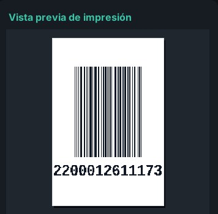
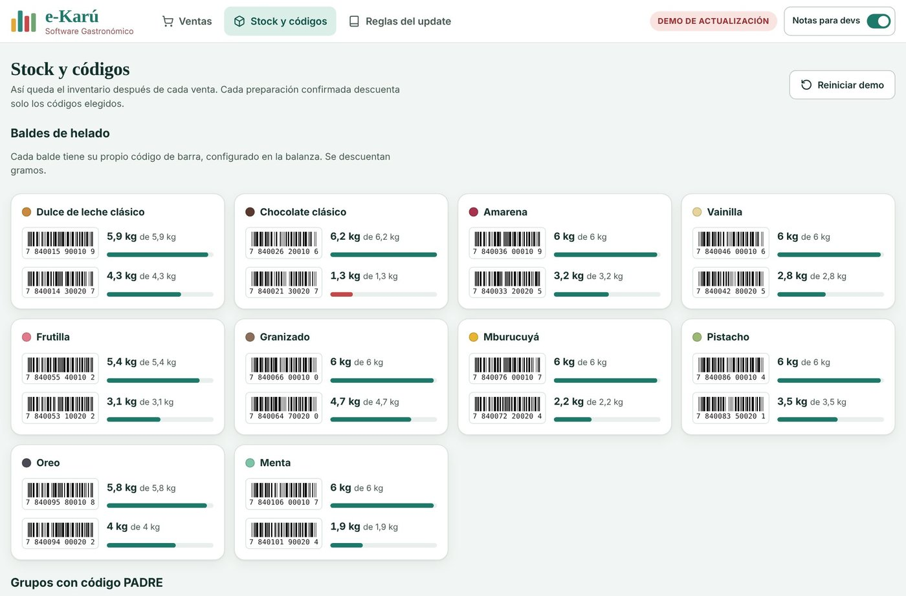

# 🏷️ e-Karú Etiquetas

**Etiquetas con código de barras y tabla nutricional para los productos de Glacé, en la impresora térmica HPRT HT400**

## Qué hace

- **Catálogo de productos** con su código de barras (EAN-13 válido o Code 128) y cantidad por imprimir.
- **Vista previa idéntica a lo impreso**: el código se dibuja con los mismos bits que se mandan a la impresora.
- **Impresión directa** en RAW/TSPL (sin pywin32) o por GDI, en grilla de 4 columnas, con densidad, velocidad y márgenes configurables.
- **Diagnóstico de impresión** y registro (`ekaru_impresion.log`) para cuando algo no sale.

Los baldes **no** se etiquetan aquí: los imprime la balanza con su software (Scale Manager). El proceso completo está en [ekaru-procesos](https://github.com/alvaroliuzzi-bot/ekaru-procesos).

## Empezar (Windows)

1. Instalar Python 3 desde python.org y marcar **«Add to PATH»**.
2. Doble clic en **`Iniciar_Ekaru.bat`**. La primera vez instala `customtkinter`.
3. `Crear_Acceso_Directo.bat` deja el acceso directo en el escritorio. `Iniciar_Ekaru_DEBUG.bat` abre con consola para ver errores.

## Archivos

| Archivo | Para qué |
|---|---|
| `app.py` | La aplicación: catálogo, diseño e impresión |
| `ekaru_config.json` | Impresora, densidad, velocidad, márgenes y grilla |
| `cantidades_impresion.json` | Últimas cantidades por producto |
| `codigos_cambios.csv` | Cambios de códigos del catálogo |
| `ekaru_ventas.html` | Prototipo de la pantalla de ventas de e-Karú (ver abajo) |
| `tools/` | Scripts de diagnóstico de la impresora |
| `docs/` | Catálogo de códigos, documento para desarrolladores, diseños de etiquetas de baldes |

## Prototipo de ventas incluido

`ekaru_ventas.html` muestra cómo vendería e-Karú con códigos de grupo (PADRE), sabores y stock por balde. Se abre con doble clic.

 

---

Parte de: [ekaru-procesos](https://github.com/alvaroliuzzi-bot/ekaru-procesos) · [glace-compras](https://github.com/alvaroliuzzi-bot/glace-compras) · [paginas-web](https://github.com/alvaroliuzzi-bot/paginas-web)
